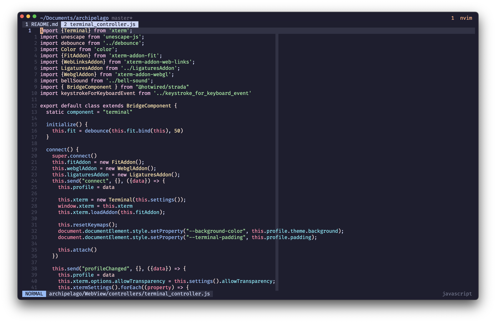

<p align="center">
  <a href="https://github.com/npezza93/archipelago#gh-light-mode-only">
    
  </a>

  <a href="https://github.com/npezza93/archipelago#gh-dark-mode-only">
    
  </a>

  <p align="center">
    Archipelago is an open-source terminal emulator built on web technology.
    <br>
    <a href="https://github.com/npezza93/archipelago/releases/download/v6.0.0/Archipelago.zip">Download now!</a>
  </p>
</p>

## Why?

Archipelago is inspired by [Hyper](https://github.com/zeit/hyper). I
started using Hyper as my default terminal while it was in beta and into
v1. It was by far the coolest, best looking, minimal, and extensible
terminal emulator I had used. But, I found it to be really slow, to the
point where if I was going to run a command that I knew would have a lot of
output, I would opt for using a different terminal. Along with that,
occasionally buffers would overlap making the terminal unreadable and
force me to restart.

At the time Hyper was using [Hterm](https://github.com/chromium/hterm)
which was the culprit of all my issues, so I found the
[Xterm.js](https://xtermjs.org/) project which solved all these problems
and I started making Archipelago.



## Get Archipelago

### macOS

Use Homebrew Cask to download the app by running the following

```bash
❯ brew install --cask archipelago
```

or

[Download](https://archipelago-terminal.herokuapp.com/download/osx)

## Contributing

Bug reports and pull requests are welcome on [GitHub](https://github.com/npezza93/archipelago).

## Development

Install [Bun](https://bun.sh), then build the bundled web resources:

```sh
cd archipelago/WebView
bun install --frozen-lockfile
bun run build
bun test
```

Open the app in Xcode to build and run the macOS application. Generated
`application.min.js` and `settings.min.js` are committed because Xcode bundles
them directly.

Archipelago uses the official **libghostty-vt 1.0.0 WebAssembly** release with a
direct JavaScript binding to its stable C API. The WASM bytes are embedded in
the application script so WKWebView can initialize from `file://` while offline.
Artifact provenance, signature verification, and update instructions are in
[WebView/vendor](archipelago/WebView/vendor/README.md).

For browser integration checks against the bundled application and a simulated
native bridge:

```sh
bunx playwright install chromium webkit
bun run test:browser
bun run test:browser webkit
bun run test:ligatures
bun run test:ligatures webkit
```

The browser checks cover WASM initialization, PTY subscription and initial size,
keyboard input, live profile changes, resizing, and teardown. Run the native app
on macOS to validate the Swift PTY and WKWebView integration as well.
The ligature checks use a bundled JetBrains Mono font to reproduce native font
injection timing and verify always-on ligatures, including profiles that saved the old setting as disabled.

The canvas renderer supports text, ANSI colors, grapheme clusters, selection,
scrollback, always-on font ligatures, and cursor styles. Ctrl/Cmd-click opens plain URLs
and OSC 8 hyperlinks. Kitty image rendering is not implemented; image storage is
disabled when the module supports it.

## Releasing

- Create archive in Xcode with new version
- Export notarized app to dist/
- Create release in GitHub for new version
- create zip file (`ditto -c -k --keepParent dist/Archipelago.app
  dist/Archipelago.zip`)

## License

Archipelago is available as open source under the terms of the [MIT License](http://opensource.org/licenses/MIT).
